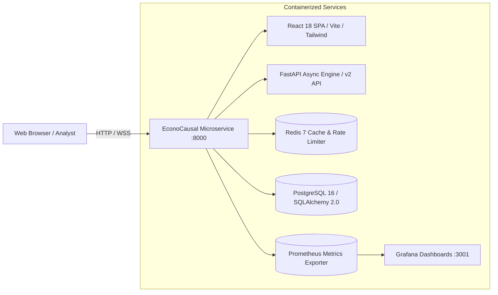

# EconoCausal: Enterprise Causal AI & Double Machine Learning Microservice Platform

[](https://www.python.org/)
[](https://fastapi.tiangolo.com/)
[](https://react.dev/)
[](https://www.postgresql.org/)
[](https://redis.io/)
[](https://docs.pytest.org/)
[](https://opensource.org/licenses/MIT)

> **Infotact Solutions Internship Project** (Ref: `ITS/DSML/1150`)  
> **Author:** Anmol Soni (Data Associate L1 Intern)  
> **Domain:** Economics, Machine Learning & Causal AI  
> **Production Release:** Version 2.0.0 (November 2026)  

---

## 📌 Executive Summary

Traditional machine learning classifiers predict **correlation**—who is likely to buy. In retail promotional campaigns, this wastes millions of marketing dollars offering discounts to loyal *Sure Things* who would purchase regardless. Conversely, standard historical data is heavily **confounded** because higher discounts were routinely given to high-spend or high-tier customers.

**EconoCausal** resolves both challenges through an end-to-end causal inference architecture:
1. **Double Machine Learning (DML)**: Employs Microsoft Research's EconML `CausalForestDML` with cross-fitting and LightGBM base learners to estimate the true **Conditional Average Treatment Effect (CATE / Uplift)** free from confounding bias.
2. **Prescriptive Optimization**: Solves a Mixed-Integer Linear Program (MILP) knapsack formulation via SciPy/HiGHS to allocate a fixed budget strictly to **Persuadable customers**, withholding discounts from *Sure Things* and *Lost Causes*.
3. **Enterprise Microservice Platform**: Production-ready asynchronous FastAPI service with React 18 single-page application, JWT auth, RBAC, Redis caching, PostgreSQL persistence, Prometheus observability, and OWASP security hardening.

---

## 🏗️ System Architecture



---

## 🌟 Key Features in Version 2.0

### 1. Advanced Causal AI & Double Machine Learning
- **Structural Causal DAGs (`src/causal_model.py`)**: Formal backdoor identification proofs via DoWhy.
- **Confounder Balancing (`src/causal_model.py`)**: Multi-class propensity scoring, positivity validation, and SMD reduction ($\text{SMD} < 0.10$).
- **Causal Forest DML (`src/dml.py`)**: Multi-armed treatment estimation ($0, $10, $20 discounts) with 5-fold cross-fitting.
- **Model Refutation Suite**: Invariant verification against Placebo Treatments, Random Common Causes, and Data Subsets.
- **Explainability**: SHAP attribution analysis highlighting driver features for individualized uplift.

### 2. High-Performance Prescriptive Optimizer
- **MILP Knapsack Formulation (`src/optimizer.py`)**: Allocates promotional budget to maximize net incremental margin:
  $$\max \sum_{i} \sum_{d} x_{i,d} \cdot \left( \widehat{\tau}_{i,d} \cdot M - d \cdot P(\text{buy}_{i,d}) \right)$$
- **Policy Constraints**: Customer frequency capping, minimum margin floors, and cohort whitelisting.

### 3. Production Microservice & Data Persistence
- **FastAPI Asynchronous Backend (`api/main.py`)**: High-throughput REST API with versioned `/api/v2/` endpoints.
- **PostgreSQL 16 & SQLAlchemy 2.0**: Relational persistence for experiments, runs, users, and audit logs.
- **Alembic Database Migrations**: Automated schema versioning (`001_initial_schema`, `002_add_indexes`).
- **Redis 7 Caching Layer (`database/cache.py`)**: Connection-pooled async cache with `@cache_response` decorator and automatic invalidation on new uploads.

### 4. Enterprise Security Hardening (OWASP Top 10)
- **JWT & API Key Authentication**: Access tokens, refresh token rotation, and constant-time `secrets.compare_digest`.
- **Brute-Force Lockout**: Automatic 15-minute account lockout after 5 failed attempts (`423 Locked`).
- **Password Complexity**: Minimum 8 characters with mixed-case, digits, and special characters.
- **OWASP Headers**: Enforced HSTS (`max-age=31536000`), CSP, `X-Frame-Options: DENY`, `X-Content-Type-Options: nosniff`.
- **CWE-1236 Defense**: CSV formula injection sanitization escaping leading `=,+,-,@`.
- **Payload & Rate Limiting**: 10MB request size limit (`413 Payload Too Large`) and sliding-window rate limiters.

### 5. Interactive Frontend & Progressive Web App (PWA)
- **10 Dedicated Operational Views**: Upload Pipeline, Causal Diagnostics, Uplift & Qini, Budget Allocation, Executive Drift, Live Metrics, Model Comparison, SHAP Explainability, Segment Explorer, and ROI Simulator.
- **Modern UI/UX**: Unified design tokens, smooth dark/light mode toggle, 18+ reusable components, and full accessibility.
- **PWA Capabilities**: Service worker offline caching, responsive mobile drawer, and installable app manifest.

---

## ⚡ Quickstart

### 1. Local Environment Setup
```powershell
# Clone the repository
git clone https://github.com/Anmol007-007/EconoCausal.git
cd EconoCausal

# Activate virtual environment
.\.venv\Scripts\Activate.ps1

# Install pinned dependencies
pip install -r requirements.txt
```

### 2. Database Migrations & Seeding
```powershell
# Apply database migrations
alembic upgrade head

# Seed initial admin & quant users
python scripts/seed_db.py
```

### 3. Run the Microservice Platform
```powershell
# Start FastAPI server (serves both API and compiled React SPA)
python -m uvicorn api.main:app --host 0.0.0.0 --port 8000 --reload
```
- **Web Application & Dashboard**: [http://localhost:8000/](http://localhost:8000/)
- **Interactive Swagger Docs**: [http://localhost:8000/docs](http://localhost:8000/docs)
- **Prometheus Telemetry**: [http://localhost:8000/metrics](http://localhost:8000/metrics)

---

## 🐳 Docker Production Deployment

Run the complete multi-service production stack (App + PostgreSQL + Redis + Prometheus + Grafana) with a single command:

```bash
docker-compose up -d --build
```

| Service | Port | Description |
|:---|:---:|:---|
| **EconoCausal App** | `8000` | FastAPI Microservice & React Single Page App |
| **PostgreSQL Database** | `5432` | Relational persistent store |
| **Redis Cache** | `6379` | In-memory cache & sliding-window rate limit |
| **Prometheus Telemetry** | `9090` | Time-series metrics engine |
| **Grafana Dashboard** | `3001` | Pre-provisioned analytics dashboard (`admin` / `econografana2026!`) |

---

## 🧪 Comprehensive Test Suites

EconoCausal maintains strict test-driven development standards with **162 passing tests**:

```powershell
# Run full pytest test suite
pytest tests/ -v

# Run security audit & vulnerability tests
pytest tests/test_security_audit.py -v

# Run end-to-end API lifecycle test
pytest tests/test_e2e_api_flows.py -v

# Run Playwright browser automation
npx playwright test

# Run Locust load testing benchmark
locust -f benchmarks/locustfile.py --headless -u 50 -r 10 --run-time 1m --host http://localhost:8000
```

---

## 📚 Technical Documentation

- 📖 [REST API Reference](file:///c:/Users/anmol/Documents/EconoCausal/docs/API_REFERENCE.md) — Full endpoint specifications and response schemas
- 🗄️ [Database Schema & ERD](file:///c:/Users/anmol/Documents/EconoCausal/docs/DATABASE_SCHEMA.md) — Relational models, data dictionary, and indexes
- 🏛️ [System Architecture](file:///c:/Users/anmol/Documents/EconoCausal/docs/ARCHITECTURE.md) — Sequence diagrams, component matrix, and latency profile
- 🚀 [Production Deployment Guide](file:///c:/Users/anmol/Documents/EconoCausal/docs/DEPLOYMENT.md) — Containerization, environment config, and scaling
- 📝 [Changelog](file:///c:/Users/anmol/Documents/EconoCausal/CHANGELOG.md) — Version release notes (v1.0 to v2.0)
- 🔒 [Security Policy](file:///c:/Users/anmol/Documents/EconoCausal/SECURITY.md) — Vulnerability disclosure and OWASP mitigations
- 🤝 [Contributing Guidelines](file:///c:/Users/anmol/Documents/EconoCausal/CONTRIBUTING.md) — Developer setup and PR standards

---

## 📄 License & Attribution

This project is licensed under the **MIT License** — see the [LICENSE](LICENSE) file for details.  
*Developed as part of the Infotact Solutions Internship Program (`ITS/DSML/1150`).*
