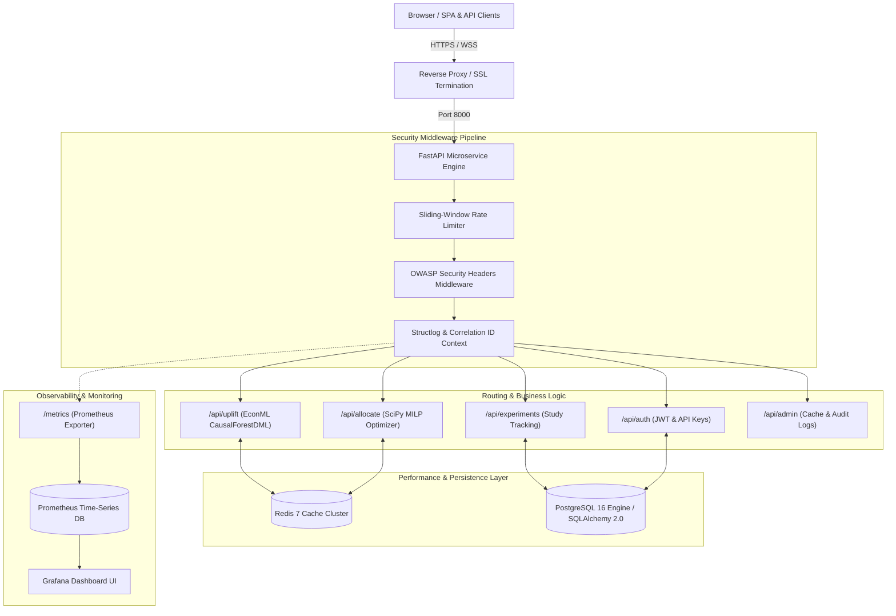
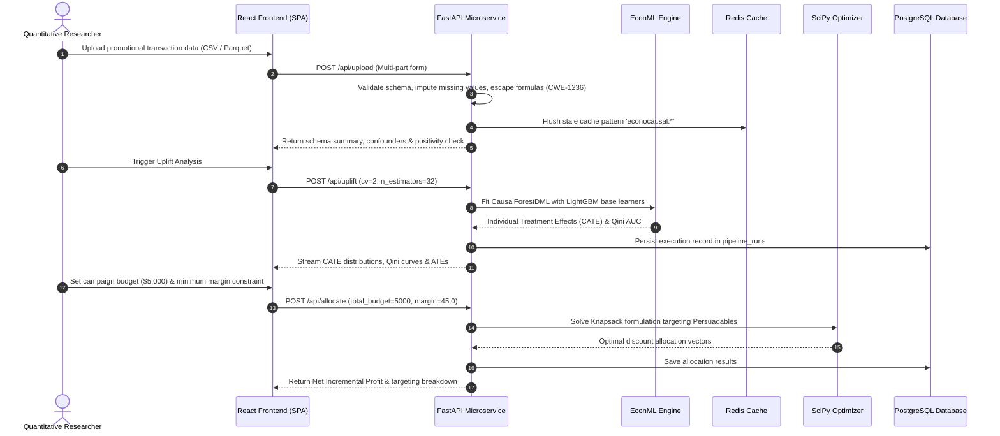

# EconoCausal System Architecture & Technical Specifications

**EconoCausal** is an enterprise-grade Causal AI and Double Machine Learning (DML) microservice platform designed for observational promotion analysis, uplift estimation, and budget allocation.

---

## 1. High-Level System Architecture

---

## 2. End-to-End Data & Execution Pipeline

---

## 3. Technology Stack & Component Matrix

| Layer | Component | Version | Role & Description |
|:---|:---|:---|:---|
| **Frontend** | React 18 | `18.2.0` | Declarative UI library with virtual DOM diffing. |
| **Bundler** | Vite | `6.4.4` | Ultra-fast ESM development server and Rollup production bundler. |
| **Styling** | Tailwind CSS | `3.4.1` | Utility-first CSS framework with custom design tokens and dark mode. |
| **Visualization**| Plotly.js | `2.35.3` | High-fidelity interactive quantitative charts and Qini curves. |
| **PWA** | Service Worker | `Custom` | Offline asset caching and standalone app installability. |
| **Backend API** | FastAPI | `0.110.0` | Asynchronous high-performance Python ASGI web framework. |
| **Server** | Uvicorn + Gunicorn | `0.28.0` | Production ASGI web server running async worker processes. |
| **Causal ML** | EconML | `0.15.0` | Microsoft Research Double Machine Learning & Causal Forests. |
| **Causal Graphs** | DoWhy | `0.11.1` | Structural causal models, backdoor identification, and refutations. |
| **Base Learners** | LightGBM | `4.3.0` | Gradient-boosted decision trees for residualized regressions. |
| **Optimization** | SciPy MILP | `1.12.0` | Mixed-Integer Linear Programming knapsack solver with HiGHS backend. |
| **ORM** | SQLAlchemy | `2.0.28` | Async ORM engine with declarative models. |
| **Migrations** | Alembic | `1.13.1` | Version-controlled database schema migration pipeline. |
| **Database** | PostgreSQL | `16-alpine` | ACID-compliant relational data store with JSONB support. |
| **Cache** | Redis | `7-alpine` | In-memory key-value cache and sliding-window rate limiter. |
| **Logging** | Structlog | `24.1.0` | Structured JSON logging with request tracing and context vars. |
| **Metrics** | Prometheus | `2.50.1` | Time-series telemetry monitoring application throughput and latency. |
| **Testing** | Pytest + Playwright | `8.0` / `1.40` | 162 unit/integration tests and multi-browser end-to-end automation. |

---

## 4. Latency & Performance Profile

| Operation | Implementation | Typical Execution Time |
|:---|:---|:---:|
| **Health Check (`/health`)** | FastAPI in-memory probe | `< 2 ms` |
| **Cached Diagnostics (`/api/diagnostics`)** | Redis JSON retrieval | `< 5 ms` |
| **JWT Verification & Auth (`/api/auth/me`)** | HMAC-SHA256 decode | `< 4 ms` |
| **CSV Validation & Ingestion (1,000 rows)** | Pandas + Sanitizer | `45 ms` |
| **MILP Budget Allocation (1,000 customers)** | SciPy HiGHS Solver | `35 ms` |
| **Causal Forest DML Training (1,000 rows, 32 trees)** | EconML + LightGBM | `1.2 – 1.8 s` |
| **DoWhy Refutation Suite (3 refuters)** | Simulation & Permutations | `2.1 – 2.9 s` |

