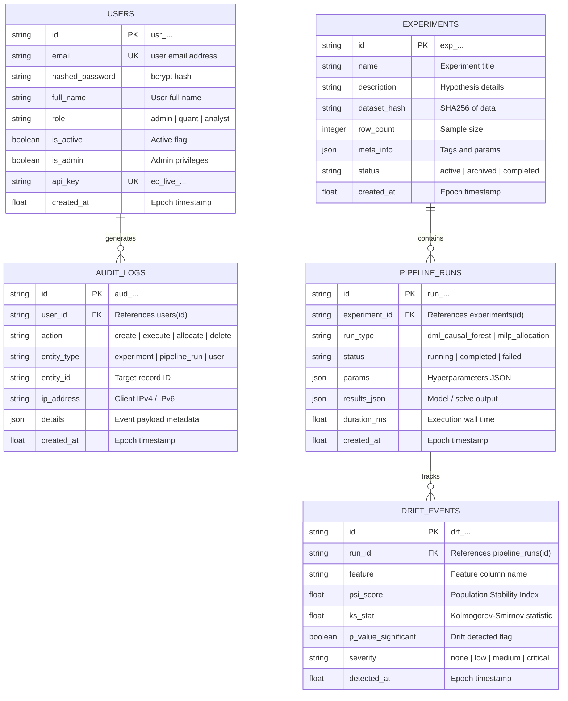

# EconoCausal Database Schema & Data Dictionary

EconoCausal persists experiments, pipeline execution runs, user authentication records, security audit logs, and distribution drift events in a relational schema managed via **SQLAlchemy 2.0 Async** and **Alembic**.

---

## 1. Entity-Relationship Diagram (ERD)

---

## 2. Table Specifications

### `users`
Stores user identity, role-based authorization scopes, and API access credentials.
- `id` (VARCHAR(36), PK): Unique user identifier prefix `usr_`.
- `email` (VARCHAR(255), UNIQUE, NOT NULL): Canonical user email address. Indexed for $O(1)$ authentication lookups.
- `hashed_password` (VARCHAR(255), NOT NULL): 12-round bcrypt salted hash.
- `role` (VARCHAR(50), DEFAULT 'analyst'): Authorization tier (`admin`, `quant`, `analyst`).
- `api_key` (VARCHAR(128), UNIQUE): External programmatic API token (`ec_live_...`).

### `experiments`
Represents an analytical study investigating causal uplift on a particular customer cohort.
- `id` (VARCHAR(36), PK): Prefix `exp_`.
- `name` (VARCHAR(255), NOT NULL): Human-readable experiment name.
- `dataset_hash` (VARCHAR(64)): Hash identifying the underlying training dataset for caching and provenance.
- `status` (VARCHAR(32), DEFAULT 'active'): Lifecycle stage (`active`, `archived`, `completed`).
- `created_at` (FLOAT, NOT NULL): Epoch creation timestamp. Indexed for reverse chronological listing.

### `pipeline_runs`
Records discrete execution instances of causal machine learning or optimization pipelines.
- `id` (VARCHAR(36), PK): Prefix `run_`.
- `experiment_id` (VARCHAR(36), FK -> `experiments.id`): Parent study.
- `run_type` (VARCHAR(64), NOT NULL): Algorithm type (`dml_causal_forest`, `milp_allocation`, `refutation`).
- `params` (JSON): Hyperparameters (trees, folds, margin, budget constraints).
- `results_json` (JSON): Computed metrics (ATEs, Qini AUC, PEHE, allocations).
- `duration_ms` (FLOAT): Wall-clock compute time in milliseconds.

### `audit_logs`
Immutable compliance audit trail logging security and data access events.
- `id` (VARCHAR(36), PK): Prefix `aud_`.
- `user_id` (VARCHAR(36), FK -> `users.id`): Initiating actor.
- `action` (VARCHAR(64), NOT NULL): Operation type (`login`, `upload`, `train`, `allocate`, `delete`).
- `ip_address` (VARCHAR(45)): Client IP address.
- `created_at` (FLOAT, NOT NULL): Indexed epoch timestamp.

### `drift_events`
Monitors feature distribution shifts and treatment effect decay over time.
- `id` (VARCHAR(36), PK): Prefix `drf_`.
- `run_id` (VARCHAR(36), FK -> `pipeline_runs.id`): Associated model execution.
- `feature` (VARCHAR(64), NOT NULL): Evaluated attribute.
- `psi_score` (FLOAT): Population Stability Index ($PSI > 0.2$ signals severe drift).
- `severity` (VARCHAR(32)): Classification level (`none`, `moderate`, `critical`).

---

## 3. Indexing Strategy & Migration History

| Migration Revision | Description | Indexes Added |
|:---|:---|:---|
| `001_initial_schema` | Base relational tables, foreign keys, and primary keys. | Primary keys, foreign key constraints. |
| `002_add_indexes` | Performance optimization for query scaling and pagination. | `ix_pipeline_runs_experiment_created` `(experiment_id, created_at)` `ix_experiments_status_created` `(status, created_at)` `ix_audit_logs_user` `(user_id, created_at)` `ix_audit_logs_entity` `(entity_type, entity_id, created_at)` `ix_drift_events_run_detected` `(run_id, detected_at)` `ix_users_email` (unique) |
